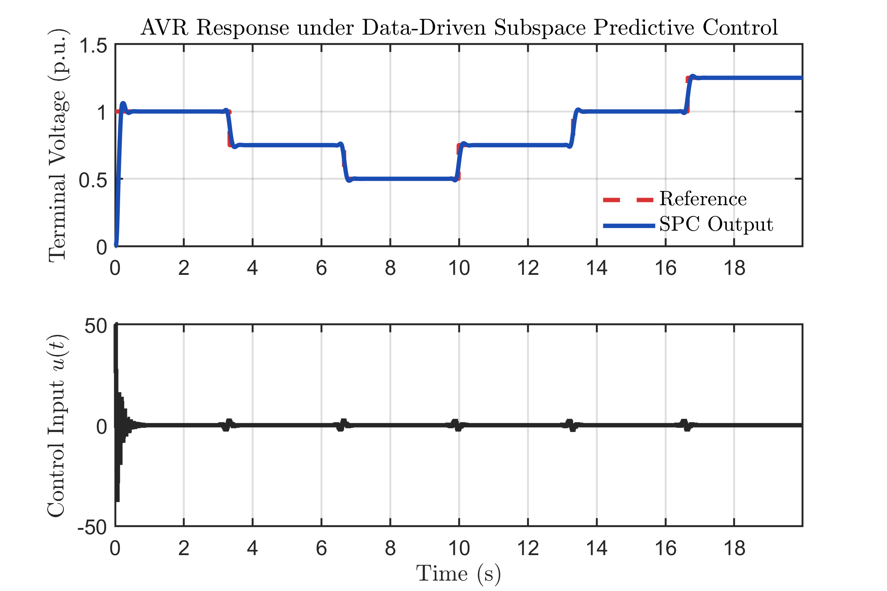

# Subspace Predictive Control (SPC) for Automatic Voltage Regulator


This repository provides a implementation of **Subspace Predictive Control (SPC)** applied to a classical Automatic Voltage Regulator (AVR) system.  

The code is released as a **comparative baseline** for the data-driven control methods developed in the following paper:

> **Karimzadeh, A., Mousavi, S. A., & Asemani, M. H. (2026).**  
> Robust data-driven control of Automatic Voltage Regulators using DeePC: Regularization techniques under noise and uncertainty.  
> *International Journal of Electrical Power & Energy Systems*, 178, 111973.  
> [https://doi.org/10.1016/j.ijepes.2026.111973](https://doi.org/10.1016/j.ijepes.2026.111973)

If you use this code or build upon it, **please cite the paper above**.

---

## Algorithm Overview

Subspace Predictive Control is a data-driven predictive control method that directly constructs a multi-step ahead predictor from input-output data, without explicitly identifying a state-space model.

### 1. Data Collection
A persistently exciting input sequence is applied to the system and the corresponding output trajectory is recorded.

### 2. Construction of Hankel Matrices
Past and future input/output data are arranged into Hankel matrices:

\[
U_P,\; U_F,\; Y_P,\; Y_F
\]

### 3. Linear Predictor Identification
A linear predictor of the form

\[
Y_F = P_{y} Y_P + P_{u_p} U_P + P_{u_f} U_F
\]

is obtained by solving a least-squares problem (via SVD-based pseudoinverse).

### 4. Online Optimization
At each time step the following quadratic program is solved:

\[
\begin{aligned}
\min_{U_F} \quad & \| Y_F - Y_{\text{ref}} \|_Q^2 + \| U_F \|_R^2 \\
\text{s.t.} \quad & u_{\min} \leq U_F \leq u_{\max}
\end{aligned}
\]

Only the first input of the optimal sequence is applied to the plant (receding horizon principle).

---

## Requirements

- MATLAB R2020b or newer
- Control System Toolbox
- [OSQP](https://osqp.org/) solver (recommended)

---

## How to Run

1. Clone the repository
2. Make sure OSQP is installed and on the MATLAB path
3. Run `main_SPC_AVR.m`

---
---
## Simulation Results

The figure below shows the closed-loop performance of the SPC controller on the AVR system.


---
## Citation

```bibtex
@article{karimzadeh2026robust,
  title   = {Robust data-driven control of Automatic Voltage Regulators using DeePC: Regularization techniques under noise and uncertainty},
  author  = {Karimzadeh, Abdollah and Mousavi, Seyed Aref and Asemani, Mohammad Hassan},
  journal = {International Journal of Electrical Power \& Energy Systems},
  volume  = {178},
  pages   = {111973},
  year    = {2026},
  publisher = {Elsevier}
}
